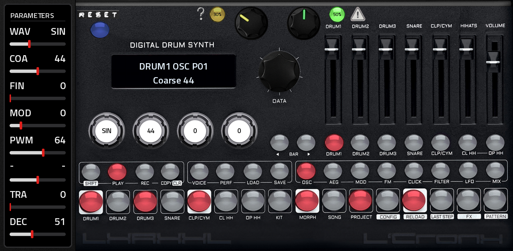

# LXRXXL v0.5.7



**Tested on an Akai Force** (see `tested.json`). Downloads: [Releases](https://github.com/sunskiefer/LXR02XXL/releases).

A port of the open-source Sonic Potions **LXR** engine to the Akai Force and MPC (MPC OS 3.x, VST2 through
[mpc-vst-plugins](https://github.com/sd88me/mpc-vst-plugins)), with LXR-02-style features written from the manual.
Inspired by the Erica Synths LXR-02. The whole panel on one page: display, four pots, data encoder, the 7 faders, every
button with its LED, and the 16 step keys, playable from the touchscreen and from the Force's pads.

## Sound

The six voices (DRUM1-3, SNARE, CLAP/CYMBAL, HIHAT) are the LXR's own DSP code, compiled unchanged from
[LXR02Open](https://github.com/brendanclarke/LXR02Open) (Brendan Clarke's port of Sonic Potions LXR 0.37 to the
LXR-02 hardware): oscillators, the transient generator, the filters (LP HP BP UBP Nch Pek LP2), the envelopes, LFOs,
velocity modulation, FM, decimation, the parameter value curves and the CC handler. They run at the machine's rate in
its 32-sample blocks, mixed the way the LXR-02's mixer mixes them (fader ramps, pan law, routing to the main out).

The LXR-02's own firmware (Erica Synths, v1.70) is closed source, so what it adds over 0.37 was written here from the
owner's manual and the v1.7 changelog, with the firmware's names and value lists:
- the **PWM** waveform (in the waveform list where 0.37 had the cymbal wave: Sin Tri Saw Rec Noi PWM) with its pulse
  width;
- the **FX unit** (off, drive tub/fld/clp, ring modulator, compressor 1:1 to 8:1, delay and ping-pong delay), fed by
  the voices routed to "FX", out to the main out;
- the **sequencer**: 64 patterns of 7 tracks x 64 steps (4 bars), per-track length, step velocity, note, probability
  and two parameter locks per step, manual rolls, shuffle, songs, recording, the euclidean pattern generator, kit
  morphing and kit change with the pattern; per-step parameters show while a step is held (two at most, the oldest
  replaced, as in v1.7).

## The page

The panel by Suns Kiefer, laid out like the LXR-02's, at MPC's full height on the right, the PARAMETERS column on the left.

| Area | What |
|---|---|
| Display | the LXR's two LCD lines, in the panel's display window |
| PARAMETERS | the values of the menu page shown on the display, named as the LXR names them, each with a bar to drag; a page with fewer values shows fewer rows |
| 4 pots | the LXR's pots: values 1-4 of the page (or 5-8, after selecting one of those). Each stands on the value it edits, full left = its minimum, full right = its maximum, and turns as the value changes; the value is printed in its white centre |
| DATA encoder | moves the selection / edits; it turns with the selection, from the first value of the page to the last (or the first slot to the last when loading/saving); a tap on the "DATA" legend under it is the encoder's push (it blinks red when there is something to confirm) |
| 7 faders | DRUM1 DRUM2 DRUM3 SNARE CLP/CYM HIHATS VOLUME (the LXR-02's fader curve) |
| Keys | SHIFT PLAY REC COPY/CLR VOICE PERF LOAD SAVE / OSC AEG MOD FM CLICK FILTER LFO MIX / BAR< BAR> and the 7 voices; lit red with their LED |
| Step keys | 1-16: grey = step off, red = step on; the SHIFT function is printed under each key |

On the touchscreen **SHIFT** and **COPY/CLR** latch: tap SHIFT, then the key (the SHIFT LED shows it is armed); the
pads have real press-and-hold. **LOAD / SAVE**: tap LOAD or SAVE, then the data key (KIT 8, MORPH 9, SONG 10,
PROJECT 11, PATTERN 16), as on the machine. Pick the slot with DATA (the touchscreen knob, the Force's data wheel or
Q-Link knob 8), then confirm with a tap on the blinking **DATA** legend under the knob, or tap the same data key again.
Example, changing kit: LOAD, KIT (step 8), turn DATA to the kit, tap DATA. Pressing the Force's data wheel in does not reach
plugins (only its turns do), so it does nothing here. A pattern loads on its step key.

**Q-Links:** bank 1 = the 7 faders and the data encoder on knob 8; bank 2 = the 4 pots and the data encoder on
knob 8.

**Tempo:** CONFIG (SHIFT + 12) > Tempo. "MPC" (the default) follows MPC's tempo and transport: press play on MPC
and the LXR plays, its steps on MPC's grid. With MPC stopped, the LXR's own PLAY runs it at MPC's tempo. Any BPM
number runs the LXR on its own clock.

## The mod: presets, RESET and randomizers

**Presets.** LXRXXL comes with the Hrtl LXR-02 DLC project (`presets/`): 64 kits (Lambo, Reservoir, Faders, Malware,
Zipper, Nanobyte, Kronky, Boooost, Dropbar, Goondam, SpaceD, Penalty, Dialup, Express, Necro, Mist and init kits) and
16 demo patterns, each with its kit (kit change mode "auto", so selecting a pattern brings its kit). A new LXRXXL
starts on this project, on pattern 1; an MPC project you saved opens as you saved it.

**RESET** (blue key, top left): back to the factory project, pattern 1 with its kit, the sequencer stopped. Anything
not saved is replaced.

Two keys and two knobs for randomizing, along the top of the panel (each key shows its knob's amount):

- **RANDOM** (green key with the warning sign, green knob 0-100 % in steps of 10): every sound parameter of the six voices moves up or down
  by a random amount of up to the knob's share of its range, each on its own draw, so the voices change differently.
  A parameter never lands where it is, nor back where it was before the last press. Whatever would silence a voice
  keeps at least 30 %: the voice volumes, the amp envelope decays, the oscillator pitch and a filter's cutoff (a
  high-pass cutoff at most 70 %, an attack at most 70 %). The outputs and the modulation routings stay as they are.
  The key lights up brighter for a moment. **With SHIFT only the selected voice** changes.
- **SEQ RND** (yellow key with the question mark, yellow knob): a new beat on the pattern, a euclidean rhythm per voice. At n % each voice
  gets about n % of its track's steps (between half and all of that, drawn per voice), spread evenly, turned by a
  random rotation, with random accents. Every press is a new beat; it replaces the voices' steps. **With SHIFT only
  the selected voice** gets a new beat, at the knob's density.

The two knobs are on Q-Link bank 2 (knobs 5 and 6), and MPC's project keeps their settings.

## Force pads

**Sequencing from MPC / the Force step sequencer:** the drum pads play the LXR's voices in the order of its voice
keys: pad 1 (bottom left) = DRUM1, pad 2 = DRUM2, pad 3 = DRUM3, pad 4 = SNARE, pad 5 = CLP/CYM, pad 6 = CL HH,
pad 7 = OP HH. The voices answer the notes the Force's pads send in their default layout, the C major scale from
C1 (pads 1-7 = notes 36, 38, 40, 41, 43, 45, 47), and the drum-pad patch's (pad n sends note n - 1). With the
Force's pads in another layout or key, set each voice's note on its MIX page. Pads 8-16 are silent. With MPC stopped, the display shows
what each pad hit played ("note 36 > DRUM1"). MPC's play also plays the LXR's pattern: to sequence only from the Force,
clear the pattern (SHIFT + COPY/CLR, choose "pattern", COPY/CLR) or pick an empty one (patterns 17-64).

Any other note on the global channel plays the selected voice at that pitch. After pad learn (below) the pads are the
LXR's panel instead, row by row from the bottom:

| Row | Pads 1-8 |
|---|---|
| 6 | - - - - - - - OP HH |
| 5 | BAR< BAR> DRUM1 DRUM2 DRUM3 SNARE CLP/CYM CL HH |
| 4 | OSC AEG MOD FM CLICK FILTER LFO MIX |
| 3 | SHIFT PLAY REC COPY/CLR VOICE PERF LOAD SAVE |
| 2 | steps 9-16 |
| 1 | steps 1-8 |

**Pad learn**, once per device: CONFIG > **lrn**, then hit three pads: the bottom-left pad, the pad right of it, the
pad above it. The display shows the notes they sent, then "Pads learned". The pads need a layout where no two send
the same note (a chromatic layout whose rows don't repeat each other's notes); with rows that overlap the display says
"Pads overlap" and the pads keep playing the drums. CONFIG > **pad** "nte" switches the panel off again (the pads
play the drums), "pnl" back on. A plugin can't light the Force's pads, so the LEDs are on the screen.

## MIDI

Each voice listens on its own MIDI channel and note (MIX page; by default channel 1, notes 36-42); the global channel
(CONFIG) plays the selected voice tonally. While the pads are the panel, the notes they send work the panel, not the voices. CC n sets sound
parameter n-1 and NRPN the parameters from 128 (the LXR's CC/NRPN list), NRPN 100-105 the PWM of voices 1-6 and
106-116 the FX unit, CC1 morphs, program change selects the pattern.

## Artwork

Artwork by Suns Kiefer.

## Presets from an LXR-02

`tools/import_lxr02.py <LXR-02 project folder>` turns an LXR-02 project (its SD card's `NN-NAME.SND` kits and `NN-.PAT`
patterns, firmware 1.70) into the factory content (`src/factory_data.c`); the file layouts are described at its top.
The LXR-02's modulation targets for pulse width and the FX unit have no modulation in this engine: those few are set
off (6 in the Hrtl project). Songs and the global settings file are not imported.

## Data

Projects (64 kits, 64 patterns, 64 songs and the settings each) are saved in `/sdcard/LXRXXL/Projects`, outside the
plugin folder so they survive updates. MPC's own project also keeps each instance's whole state.

## Installing

Needs root SSH access to the device (for example MockbaMod) and MPC OS 3.x. Unzip the release, then:

```
scp -r LXRXXL-<version> root@<device-ip>:/tmp/
ssh -t root@<device-ip> sh /tmp/LXRXXL-<version>/install.sh
```

The installer stops MPC (save first), copies the plugin to `/sdcard/Synths/ANDREALPHEUS - VST - LXRXXL/`, adds it to
MPC's plugin list and starts MPC again. Load **LXRXXL** (ANDREALPHEUS) as a plugin instrument. `uninstall.sh` removes
it. INSTALL.md in the zip has the manual steps.

## Building

Python 3 with Pillow, numpy and scipy, a host gcc and clang, Zig (`pip install ziglang`); valgrind and qemu-user for the tests. No Docker.

```
git clone https://github.com/sunskiefer/LXR02XXL
cd LXR02XXL
./build.sh             # build/arm/lxrxxl.so + the skin -> build/package/
test/run_tests.sh      # the wrapper's host test and the engine tests, under valgrind
test/arm_sim.sh        # the MPC simulation built for ARM, run under qemu-arm
```

`tools/gen_params.py` is the parameter list (appended only: MPC stores automation by index), `tools/panel.py` the
page geometry (it writes `layout.conf`), `tools/panel_art.py` the artwork, `tools/preview.py` a picture of the built
page. The LXR engine's globals are swapped per instance (`src/lxr_state.c`), so several LXRXXLs can play at once.
Changes to the vendored LXR code are listed in [PATCHES.md](PATCHES.md).

## License and credits

- LXR DSP and parameter code: Julian Schmidt (Sonic Potions LXR), Brendan Clarke (LXR02Open). Under the LXR02
  Open-Source license (`third_party/lxr02open/LICENSE`): **not for sale or commercial use**, and a binary must come
  with its complete source. LXRXXL's own code is under the same terms, and every release includes its source.
- VST2 wrapper, skin builder and installer: sd88me, [mpc-vst-plugins](https://github.com/sd88me/mpc-vst-plugins) (MIT).
- Interface font: Titillium Web, SIL Open Font License 1.1.

LXRXXL is not affiliated with or endorsed by Sonic Potions, Erica Synths or Akai Professional. LXR-02 is their trademark.
